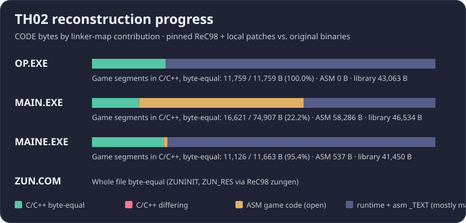

# 東方封魔録 ～ the Story of Eastern Wonderland

Agent workflow: follow the highest-priority requirements in [AGENTS.md](AGENTS.md). Use affected exact checks and searchable Markdown knowledge; ordinary notes do not require full CI or replay.

<p align="center">
  
</p>

This repository reconstructs the original Japanese PC-98 **Touhou 2: the
Story of Eastern Wonderland** (`OP.EXE`, `MAIN.EXE`, `MAINE.EXE`, `ZUN.COM`).

[Progress](docs/PROGRESS.md) · [Handoff](docs/RE_HANDOFF.md) · [ReC98 import](docs/REC98_IMPORT.md) · [Workflow](docs/RE_WORKFLOW.md) · [Architecture](docs/ARCHITECTURE.md)

## Starting point

Most of TH02 outside MAIN's gameplay has already been decompiled by
[ReC98](https://github.com/nmlgc/ReC98). This project builds that pinned work
with the original Borland toolchain and compares every linker-map contribution
with the original binaries:

- `ZUN.COM` is byte-identical.
- Every ReC98 C/C++ unit in `OP.EXE`, `MAIN.EXE` and `MAINE.EXE` is byte-equal
  after one local fix (a signed loop compare in MAIN's bomb code).
- The remaining differences are 19 bytes in ReC98's assembly files plus EXE
  header/relocation order. Most of MAIN's gameplay is still assembly.

Details are in [the import notes](docs/REC98_IMPORT.md).

## Build

Private inputs (original programs, Borland tools, Ghidra projects) are not in
Git. With them in place:

```sh
python3 scripts/import_targets.py /path/to/jp.hdi   # extracts and verifies HUMAROKU/
python3 scripts/attest_toolchain.py
python3 scripts/build_th02.py --run-id NAME --write-ledger
python3 scripts/progress.py
```

See [TOOLCHAIN.md](docs/TOOLCHAIN.md) and [GHIDRA.md](docs/GHIDRA.md).

## Credits

**ZUN** ([上海アリス幻樂団 / Team Shanghai Alice](https://www16.big.or.jp/~zun/))
created Touhou Project and the original TH02 game, characters, artwork and music.

- **[ReC98](https://github.com/nmlgc/ReC98)**, by **nmlgc and contributors**:
  the TH02 decompilation this project starts from, plus PC-98 research,
  hardware definitions and the DOS build pipeline. ReC98 is used from a pinned
  checkout and is not redistributed here.
- **[master.lib](https://github.com/nmlgc/ReC98/tree/master/libs/master.lib)**:
  the PC-98 system library linked into TH02.
- **KAJA / PMD**: the PC-98 music driver shipped with the game.
- Workflow and tooling follow our [TH03](https://github.com/N0zoM1z0/th03)
  and [TH04](https://github.com/N0zoM1z0/th04) reconstructions.
- **[Ghidra](https://github.com/NationalSecurityAgency/ghidra)**,
  **[Wine](https://www.winehq.org/)**, **[mtools](https://www.gnu.org/software/mtools/)**
  and ReC98's **[MS-DOS Player](https://github.com/nmlgc/msdos-player)** build:
  analysis, DOS toolchain execution and disk-image extraction.

Project-authored code and documentation use the [MIT License](LICENSE).
Patches under `patches/rec98/` modify ReC98 files and are offered for
upstream use.
